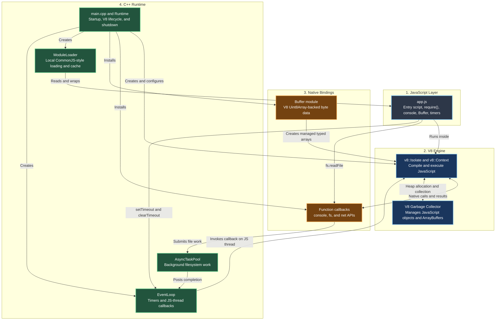

# MiniNode

**A small JavaScript runtime built in C++ for learning how Node.js works.**

V8 runs the JavaScript. MiniNode supplies a small host environment around it.

MiniNode is a hobby project for exploring the boundary between a JavaScript
engine and a runtime. The goal is not to reimplement all of Node.js. The goal
is to understand the pieces by building a small version, then compare selected
ideas and workloads with Rust and other languages.

The C++ project is in the repository root. The Rust project under `src/` is
separate; this CMake build does not compile or modify it.

## Two Learning Tracks

- **C++ MiniNode:** The root C++ runtime embeds V8 and runs its root-level `app.js` by default. Pass another JavaScript path to run a different script.
- **Rust runtime experiments:** The separate Rust project under `src/` is a future, independent track for exploring Deno- and Bun-inspired runtime ideas; it is not part of the C++ executable or a completed clone.

The two tracks can eventually run comparable JavaScript workloads, while
keeping their runtimes and implementations separate.

## What It Teaches

JavaScript engines execute the language, but a runtime provides the surrounding
environment: loading files, exposing native APIs, managing callbacks, and
deciding when the process can exit. MiniNode embeds Google's V8 engine and
implements a small set of those runtime responsibilities in C++.

### Runtime Flow

This diagram follows the C++ MiniNode path. The Rust runtime experiments are
separate and are not shown here.



At a high level, startup works like this:

1. Initialize V8 and create an isolate and JavaScript context.
2. Install native globals such as `console`, `Buffer`, and timers.
3. Read the entry script and wrap local modules in a CommonJS-style function.
4. Execute JavaScript through V8; native callbacks call back into C++.
5. Process queued file callbacks, timers, and JavaScript microtasks.
6. Release V8 handles, the isolate, and the platform during shutdown.

## Current Features

- V8 embedding, context setup, script execution, and error reporting.
- `console.log`, `console.info`, `console.warn`, and `console.error`.
- `require()` for local `.js` files, with a simple module cache.
- Built-in modules: `fs`, `buffer`, and `net`.
- `fs.readFile`, `fs.readFileSync`, `fs.writeFileSync`, and `fs.existsSync`.
- `Buffer.alloc`, `Buffer.from`, `Buffer.isBuffer`, and UTF-8 `toString()`.
- `setTimeout` and `clearTimeout` in a small event loop.
- A worker pool for file reads; callbacks are delivered on the runtime thread.
- Promise microtask checkpoints and unhandled rejection reporting.
- `net.tcpRequestSync(host, port, request)` for basic TCP experiments.

`app.js` is the runnable example. It exercises built-ins, writes and reads
`mini-node-output.txt`, and schedules callbacks.

## Requirements

- macOS with Xcode Command Line Tools
- CMake
- Homebrew
- V8 development headers and libraries

Install the dependencies with Homebrew:

```sh
brew install cmake v8
```

The C/C++ extension for VS Code is optional. It provides editor support, not
the compiler or V8 libraries. CMake Tools is also optional when building from
the terminal.

## Build and Run

Run these commands from the repository root:

```sh
cmake -S . -B build \
-DCMAKE_BUILD_TYPE=Debug \
-DMININODE_V8_ROOT="$(brew --prefix v8)"
cmake --build build --target mininode --parallel
./build/mininode app.js
```

If no script path is supplied, MiniNode looks for `app.js` in the current
directory. To run another script:

```sh
./build/mininode path/to/script.js
```

For a release build, use a separate build directory:

```sh
cmake -S . -B build-release \
-DCMAKE_BUILD_TYPE=Release \
-DMININODE_V8_ROOT="$(brew --prefix v8)"
cmake --build build-release --target mininode --parallel
```

If V8 is installed somewhere else, pass its SDK root through
`MININODE_V8_ROOT`. If CMake Tools is used in VS Code, select the AppleClang
kit before configuring the project.

## Clean Builds

Remove compiled objects while keeping the CMake configuration:

```sh
cmake --build build --target clean
```

Rebuild the target from scratch while keeping the build directory:

```sh
cmake --build build --clean-first --target mininode --parallel
```

To discard the generated build directory and configure again:

```sh
cmake -E rm -rf build
cmake -S . -B build \
-DCMAKE_BUILD_TYPE=Debug \
-DMININODE_V8_ROOT="$(brew --prefix v8)"
cmake --build build --target mininode --parallel
```

Only generated build files are stored in `build/`; source files remain in the
repository root.

## Learning Roadmap

Use the project as a sequence of small runtime experiments:

1. Trace V8 initialization, isolate ownership, handle scopes, and shutdown.
2. Follow a JavaScript call such as `console.log()` into its C++ callback.
3. Inspect how `require()` resolves paths, wraps modules, and caches exports.
4. Trace `fs.readFile()` from the worker pool back to the event loop.
5. Explore how `Buffer` uses V8 typed arrays and backing stores.
6. Extend timers and microtask handling, then test process-exit behavior.
7. Add tests before expanding compatibility or adding more native modules.

Each experiment should stay small enough that the JavaScript call, native
implementation, and observable result can all be followed together.

## Limits

This is an experimental learning runtime, not a Node.js replacement. The
current implementation does not provide full Node compatibility, npm package
resolution, ES modules, TLS, or an HTTP server. `net.tcpRequestSync` is
synchronous and intended only for simple experiments. The `Buffer` API is a
small subset of Node's API. Review the source before running scripts you do not
trust: native filesystem and network APIs are not sandboxed.

## Benchmarks and Language Experiments

Benchmark results are not published yet. The plan is to compare carefully
chosen runtime experiments with equivalent implementations in C++, Rust, and
other languages as those experiments are added. No performance claim should be
inferred from the runtime's current feature list.

For useful comparisons, record the machine and OS, compiler and flags, V8
version, build type, exact command, workload, warm-up policy, and number of
repetitions. Report distributions or medians rather than a single best run.
Keep startup, JavaScript execution, filesystem I/O, and network latency as
separate workloads so they are not accidentally compared as if they measured
the same thing. Benchmark results and reproducible commands will be shared
alongside the experiments.

## Project Status

This project is developed as a hobby and learning exercise. APIs and internals
may change while the runtime is being explored. Build and run the examples
locally before relying on a feature; this project makes no production-readiness
or performance guarantees.
